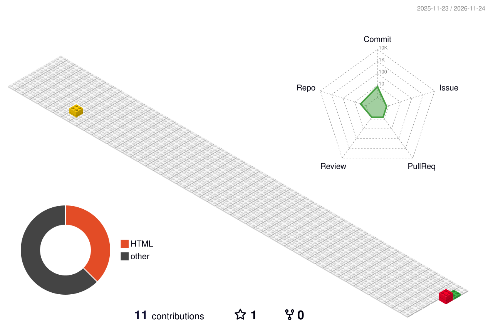

  

---

## 👋 Tentang Saya

<table>
<tr>
<td width="54%" valign="top">

Mahasiswa **Teknik Informatika** di Universitas Pamulang yang berfokus pada **infrastruktur Linux**, **jaringan komputer**, **IoT**, dan **otomatisasi AI lokal**.

 

| | | |
| :--- | :--- | :--- |
| 🎓 | **Pendidikan** | Teknik Informatika · Universitas Pamulang |
| 🐧 | **Fokus** | Linux SysAdmin, Network & Embedded/IoT |
| 🤖 | **AI & Workflow** | Ollama · n8n · Local AI Agents |
| 🔧 | **Hardware & OS** | ESP32 · OpenWrt · Arch / CachyOS |

 

> *"Membangun sistem yang menghubungkan dunia fisik dan digital."*

</td>
<td width="46%" align="center" valign="middle">

  

</td>
</tr>
</table>

---

## 🛠️ Keahlian

  

---

## 📦 Proyek Unggulan

<table>
<tr>
<td width="50%" valign="top">

</td>
<td width="50%" valign="top">

</td>
</tr>
<tr>
<td width="50%" valign="top">

</td>
<td width="50%" valign="top">

</td>
</tr>
</table>

---

## 📊 Aktivitas & Statistik 3D

---

## 🌐 Hubungi Saya

